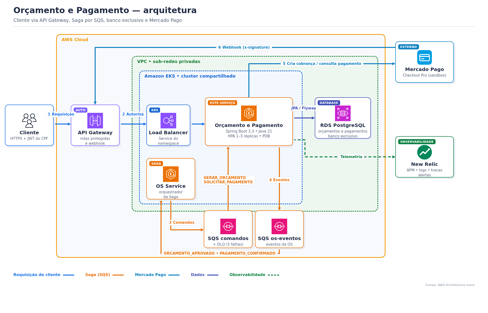
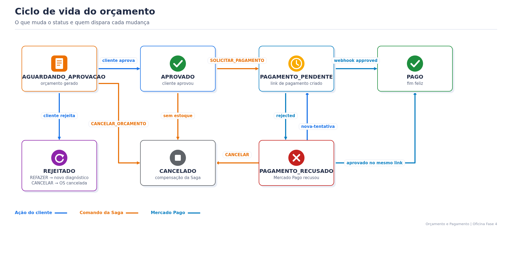
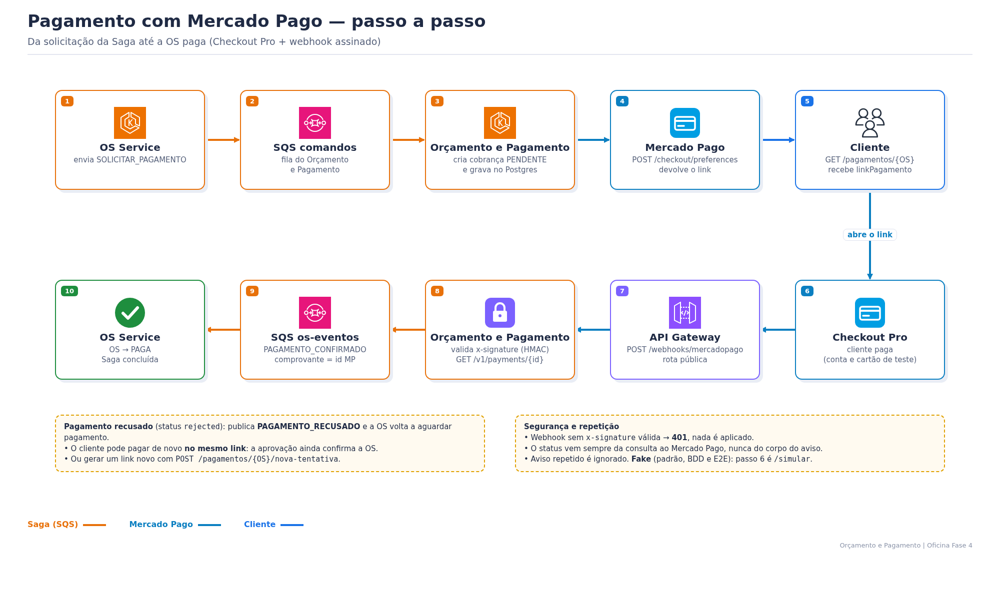

# Serviço de Orçamento e Pagamento — Oficina Fase 4

> Tech Challenge FIAP SOAT — Fase 4. Documentação central da solução: [`oficina-os-service`](https://github.com/tiagomiele/oficina-os-service#readme).

## 1. Objetivo de negócio

Depois do diagnóstico, o cliente precisa saber **quanto vai pagar**, decidir se aprova o serviço e **pagar** sem ir à oficina. Este serviço é dono dessas três etapas:

1. **Orçamento:** recebe do OS Service os itens do diagnóstico (serviços e peças) e guarda o orçamento com o valor total.
2. **Decisão do cliente:** o cliente aprova ou rejeita. Na rejeição, escolhe **refazer** o diagnóstico ou **cancelar** a OS.
3. **Pagamento:** depois do reparo, gera a cobrança no **Mercado Pago (Checkout Pro)**, recebe o resultado pelo webhook e avisa a Saga (pago ou recusado). Depois de uma recusa, o cliente pode gerar uma **nova tentativa**.

## 2. Requisitos atendidos

**Funcionais**

| # | Requisito | Onde |
|---|---|---|
| RF1 | Gerar orçamento a partir do comando `GERAR_ORCAMENTO` da Saga | `OrcamentoService.processar` |
| RF2 | Cliente consulta o orçamento só das próprias OS | `GET /orcamentos/{numeroOs}` |
| RF3 | Cliente aprova o orçamento → `ORCAMENTO_APROVADO` | `POST /orcamentos/{numeroOs}/aprovar` |
| RF4 | Cliente rejeita com `REFAZER` ou `CANCELAR` → `ORCAMENTO_REJEITADO` | `POST /orcamentos/{numeroOs}/rejeitar` |
| RF5 | Compensação: estoque insuficiente cancela o orçamento | comando `CANCELAR_ORCAMENTO` |
| RF6 | Gerar cobrança com link de pagamento | comando `SOLICITAR_PAGAMENTO` + `GET /pagamentos/{numeroOs}` |
| RF7 | Confirmar ou recusar o pagamento pelo webhook do Mercado Pago | `POST /webhooks/mercadopago` |
| RF8 | Nova cobrança depois de recusa | `POST /pagamentos/{numeroOs}/nova-tentativa` |
| RF9 | Aprovação no mesmo link depois de uma recusa também confirma o pagamento | `OrcamentoService.aplicar` |
| RF10 | Simular o provedor em local/BDD/E2E | `POST /pagamentos/{numeroOs}/simular` (só `fake`) |

**Técnicos**

| Requisito | Como |
|---|---|
| Banco próprio (SQL) | RDS PostgreSQL exclusivo, schema versionado por Flyway |
| Comunicação assíncrona | Amazon SQS: consome `orcamento-pagamento-comandos`, publica em `os-eventos`; DLQ após 5 falhas |
| Idempotência | tabela `mensagens_processadas` (por `messageId`) e máquina de estados no domínio |
| Evento só depois do commit | publicação registrada para depois da transação (`SqsPosCommitTest`) |
| Segurança | JWT HS256 (funcionário/técnico, OS Service) e RS256 (cliente, Auth Serverless); webhook com HMAC-SHA256 |
| Rastreabilidade | `correlationId` da Saga nos logs JSON e New Relic APM com distributed tracing |
| Qualidade | Clean Architecture validada por ArchUnit, JaCoCo ≥ 80% (linhas e branches), SonarCloud, Trivy, Gitleaks, SBOM |
| Escalabilidade | EKS com HPA por CPU (1 a 3 réplicas) e PDB |

## 3. Stack técnica

Java 21 · Spring Boot 3.3 (Web, Validation, Security, Actuator, JPA sem Spring Data) · PostgreSQL 16 + Flyway · AWS SDK v2 (SQS) · Mercado Pago Checkout Pro (API REST via `RestClient`, sem SDK) · springdoc-openapi 2.6 (Swagger) · JUnit 5, Testcontainers (Postgres + LocalStack), ArchUnit, JaCoCo · Spotless · Docker · Kubernetes (EKS) · GitHub Actions + GHCR · SonarCloud · New Relic Java agent.

## 4. Arquitetura



Clean Architecture com 4 camadas, validada por ArchUnit (`ArchitectureTest`):

| Pacote | Responsabilidade |
|---|---|
| `domain` | `Orcamento`, `Pagamento` e as máquinas de estado (`StatusOrcamento`, `StatusPagamento`), sem Spring |
| `usecase` | `OrcamentoService` e as portas (`PagamentoGateway`, `MensageriaGateway`, repositórios) |
| `adapter` | REST, webhook, JPA, SQS, Mercado Pago/fake e JWT |
| `infrastructure` | configuração (segurança, OpenAPI, mensageria, provedor) |

**Estados do orçamento**



## 5. Participação na Saga

Contrato completo: [`oficina-os-service/docs/saga/contrato-mensagens.md`](https://github.com/tiagomiele/oficina-os-service/blob/homolog/docs/saga/contrato-mensagens.md).

| Recebe (fila `oficina-<env>-orcamento-pagamento-comandos`) | Efeito |
|---|---|
| `GERAR_ORCAMENTO` | novo orçamento `AGUARDANDO_APROVACAO` com itens e valor |
| `CANCELAR_ORCAMENTO` | compensação: orçamento `CANCELADO` |
| `SOLICITAR_PAGAMENTO` | orçamento `PAGAMENTO_PENDENTE` e cobrança criada no provedor |

| Gatilho | Publica (fila `oficina-<env>-os-eventos`) |
|---|---|
| `POST /orcamentos/{numeroOs}/aprovar` | `ORCAMENTO_APROVADO` |
| `POST /orcamentos/{numeroOs}/rejeitar` | `ORCAMENTO_REJEITADO` (`acao` = `REFAZER` ou `CANCELAR`) |
| webhook com pagamento aprovado | `PAGAMENTO_CONFIRMADO` (`comprovante` = id do pagamento no Mercado Pago) |
| webhook com pagamento recusado | `PAGAMENTO_RECUSADO` (`motivo` = `status_detail`) |

Mensagem que falha 5 vezes vai para a DLQ `oficina-<env>-orcamento-pagamento-comandos-dlq`.

## 6. Integração com o Mercado Pago

**Objetivo:** cobrar o cliente com um meio de pagamento real (cartão, saldo, Pix) sem a oficina tratar dados de cartão. O Mercado Pago hospeda o checkout; o serviço só cria a cobrança e recebe o resultado.

**Conexões**

| Sentido | Chamada | Para quê |
|---|---|---|
| Serviço → MP | `POST https://api.mercadopago.com/checkout/preferences` (Bearer `MERCADOPAGO_ACCESS_TOKEN`) | cria a preferência: item `id` = número da OS, `external_reference` = número da OS, `notification_url` = `<API Gateway>/webhooks/mercadopago`, `statement_descriptor`, `back_urls` opcional. Devolve o `sandbox_init_point` (link) |
| MP → serviço | `POST <API Gateway>/webhooks/mercadopago?type=payment&data.id=<id>` com header `x-signature` | avisa que o pagamento mudou. A rota é pública no API Gateway, sem JWT |
| Serviço → MP | `GET https://api.mercadopago.com/v1/payments/{id}` | busca o status real (`approved`, `rejected`...) e o `external_reference`. O serviço nunca confia só no corpo do webhook |

**Fluxo completo**



**Regras importantes**

- `x-signature` = `ts=<epoch>,v1=<hex>`, onde `v1` é o HMAC-SHA256 de `id:<data.id>;request-id:<x-request-id>;ts:<ts>;`. Assinatura ausente ou errada → `401`. O MP também manda um aviso no formato antigo, sem assinatura; ele é descartado, e por isso aparece `assinatura inválida` no log sem prejuízo.
- `approved` → `PAGAMENTO_CONFIRMADO`; `rejected`, `cancelled`, `refunded` ou `charged_back` → `PAGAMENTO_RECUSADO`; outros status ficam pendentes.
- Avisos repetidos ou fora de ordem são ignorados (`já aplicada ou fora de ordem` no log).
- Se o comprador tenta de novo **no mesmo link** depois de uma recusa e é aprovado, o pagamento é confirmado.
- `MERCADOPAGO_SANDBOX=true` usa o `sandbox_init_point` (contas e cartões de teste).
- Erros da API (ex.: `invalid_access_token`) vão para o log com o código do MP, sem o token.

**Provedor fake (padrão):** `PAYMENT_PROVIDER=fake` cria um link fictício e libera `POST /pagamentos/{numeroOs}/simular?aprovado=true|false`. É o modo usado no BDD e no **Validacao E2E**. Para a demonstração com o Mercado Pago, siga a seção do Mercado Pago no [Bootstrap da Fase 4](https://github.com/tiagomiele/oficina-os-service#readme) e volte para `fake` no final.

## 7. API (Swagger)

| Método | Rota | Quem | Resultado |
|---|---|---|---|
| GET | `/orcamentos/{numeroOs}` | cliente (próprias OS), funcionário, técnico | orçamento atual |
| POST | `/orcamentos/{numeroOs}/aprovar` | cliente | `ORCAMENTO_APROVADO` |
| POST | `/orcamentos/{numeroOs}/rejeitar` | cliente | `{"acao":"REFAZER","motivo":"..."}` → `ORCAMENTO_REJEITADO` |
| GET | `/pagamentos/{numeroOs}` | cliente, funcionário, técnico | cobrança e `linkPagamento` |
| POST | `/pagamentos/{numeroOs}/nova-tentativa` | cliente | nova cobrança depois de recusa |
| POST | `/pagamentos/{numeroOs}/simular?aprovado=true` | autenticado, só `fake` | simula o resultado |
| POST | `/webhooks/mercadopago` | Mercado Pago (público, `x-signature`) | aplica o pagamento |
| GET | `/actuator/health` | público | saúde |

**Erros:** `400` corpo inválido · `401` sem token, token expirado (15 min) ou `x-signature` inválida · `403` OS de outro cliente · `404` OS sem orçamento/cobrança · `409` transição inválida (ex.: aprovar orçamento já pago). 403/404/409 vêm em Problem Details:

```json
{"type":"about:blank","title":"Conflict","status":409,"detail":"Não é possível ir de PAGO para PAGAMENTO_PENDENTE","instance":"/pagamentos/OS-102026-000003/nova-tentativa"}
```

**Abrir o Swagger com exemplos e schemas:**

```powershell
# local
Start-Process http://localhost:8080/swagger-ui.html
# AWS (troque production por homolog)
$lb = kubectl get svc oficina-orcamento-pagamento -n oficina-orcamento-pagamento-production -o jsonpath='{.status.loadBalancer.ingress[0].hostname}'
Start-Process "http://$lb/swagger-ui.html"
```

Em **Authorize**, cole o `accessToken` do cliente (`POST <AUTH_BASE_URL>/auth/cpf`) ou o token do funcionário (`POST <BACKEND_BASE_URL>/auth/login`). Contrato bruto: `/v3/api-docs`.

## 8. Banco de dados

**Objetivo:** guardar o histórico de orçamentos e de cada tentativa de pagamento da OS, isolado dos outros serviços (nenhum outro serviço acessa este banco). Recurso: RDS PostgreSQL `oficina-<env>-orcamento-pagamento-db`, criado pelo [`oficina-database-infra/orcamento-pagamento`](https://github.com/tiagomiele/oficina-database-infra/tree/homolog/orcamento-pagamento).

| Tabela | Conteúdo |
|---|---|
| `orcamentos` | um registro por orçamento da OS (`numero_os`, `id_cliente`, `status`, `valor_total`, `motivo`, `correlation_id`). Um "refazer" gera um novo orçamento |
| `itens_orcamento` | serviços e peças de cada orçamento (`tipo`, `id_servico_sku`, `quantidade`, `preco_unitario`) |
| `pagamentos` | cada cobrança: `provedor`, `referencia_externa` (preferência do MP), `pagamento_externo_id` (comprovante), `status`, `link_pagamento`, `detalhe` |
| `mensagens_processadas` | `message_id` dos comandos já aplicados (idempotência) |
| `flyway_schema_history` | versões do schema |

**Ver os dados (RDS é privado):** túnel temporário pelo cluster + DBeaver ou `psql`. Rode numa janela PowerShell e deixe aberta:

```powershell
$ns = 'oficina-orcamento-pagamento-production'   # ou oficina-orcamento-pagamento-homolog
$url = kubectl get configmap orcamento-pagamento-config -n $ns -o jsonpath='{.data.DB_URL}'
$dbHost = $url -replace '^jdbc:postgresql://([^:/]+).*$', '$1'
kubectl get configmap orcamento-pagamento-config -n $ns -o jsonpath='{.data.DB_USER}'; ''
"Database: " + ($url -replace '^.*/', '')
$b64 = kubectl get secret orcamento-pagamento-secrets -n $ns -o jsonpath='{.data.DB_PASSWORD}'
[Text.Encoding]::UTF8.GetString([Convert]::FromBase64String($b64)) | Set-Clipboard   # senha na área de transferência
kubectl run pg-tunnel -n $ns --image=alpine/socat --restart=Never -- "tcp-listen:5432,fork,reuseaddr" "tcp-connect:${dbHost}:5432"
kubectl wait pod/pg-tunnel -n $ns --for=condition=Ready --timeout=120s
kubectl port-forward -n $ns pod/pg-tunnel 15433:5432
```

No DBeaver: PostgreSQL, host `localhost`, porta `15433`, database/usuário mostrados acima, senha colada, SSL `require`. Ao terminar: `Ctrl+C`, `Set-Clipboard -Value ' '` e `kubectl delete pod pg-tunnel -n $ns`.

Consultas úteis:

```sql
SELECT numero_os, status, valor_total, motivo, atualizado_em FROM orcamentos ORDER BY id DESC LIMIT 20;
SELECT numero_os, provedor, status, pagamento_externo_id AS comprovante, detalhe, link_pagamento FROM pagamentos ORDER BY id DESC LIMIT 20;
SELECT o.numero_os, i.tipo, i.descricao, i.quantidade, i.preco_unitario FROM itens_orcamento i JOIN orcamentos o ON o.id = i.orcamento_id WHERE o.numero_os = 'OS-102026-000003';
SELECT * FROM mensagens_processadas ORDER BY processada_em DESC LIMIT 20;
```

Em produção, só consultas de leitura.

## 9. Executar

**Pré-requisitos:** Java 21 e Docker.

**Testes e build (recomendado para avaliar):**

```powershell
./mvnw spotless:apply
./mvnw verify   # testes unitários + integração (Testcontainers: Postgres e LocalStack), ArchUnit e JaCoCo ≥ 80%
start target/site/jacoco/index.html
```

**Subir só este serviço localmente** (mensageria em memória e provedor fake):

```powershell
docker run -d --name op-db -p 5433:5432 -e POSTGRES_DB=orcamento_pagamento -e POSTGRES_USER=oficina -e POSTGRES_PASSWORD=oficina postgres:16-alpine
./mvnw spring-boot:run
# http://localhost:8080/swagger-ui.html  e  http://localhost:8080/actuator/health
```

**Os 3 serviços juntos com a Saga real** (SQS no LocalStack): BDD do OS Service, em [`oficina-os-service/bdd`](https://github.com/tiagomiele/oficina-os-service/tree/homolog/bdd).

**Na AWS:** siga o Bootstrap da Fase 4 (documentação central). Este repositório só faz o deploy; banco e filas vêm do `oficina-database-infra`.

## 10. Configuração

| Variável | Padrão | Uso |
|---|---|---|
| `DB_URL` / `DB_USER` / `DB_PASSWORD` | Postgres local `5433` | RDS do Orçamento e Pagamento |
| `MENSAGERIA_TIPO` | `memoria` | `sqs` na AWS |
| `SQS_ORCAMENTO_PAGAMENTO_COMANDOS_URL` / `SQS_OS_EVENTOS_URL` | — | filas |
| `AWS_SQS_ENDPOINT` | — | só LocalStack |
| `JWT_SECRET`, `SERVERLESS_JWT_PUBLIC_KEY` | — | mesmos valores do OS Service e do Auth |
| `PAYMENT_PROVIDER` | `fake` | `mercadopago` liga o Checkout Pro |
| `MERCADOPAGO_ACCESS_TOKEN` / `MERCADOPAGO_WEBHOOK_SECRET` | — | credencial de teste e assinatura do webhook (Secrets do GitHub) |
| `MERCADOPAGO_NOTIFICATION_URL` | `<API_GATEWAY_BASE_URL>/webhooks/mercadopago` | preenchida pelo deploy |
| `MERCADOPAGO_BACK_URL` | — | HTTPS de retorno do comprador; vazio não envia `back_urls` |
| `MERCADOPAGO_STATEMENT_DESCRIPTOR` | `OFICINA` | nome na fatura |
| `MERCADOPAGO_SANDBOX` | `true` | `sandbox_init_point` ou `init_point` |

O `configure-environment.ps1 -ConfigureMercadoPago` (OS Service) grava as credenciais e troca `PAYMENT_PROVIDER` no GitHub Environment.

## 11. CI/CD

| Workflow | Quando | O que faz |
|---|---|---|
| **CI** | PR e push | valida workflows, build + testes + JaCoCo, SonarCloud (quality gate), SBOM CycloneDX/Dependency-Track, Trivy, Gitleaks |
| **CD** | push em `homolog`/`main` ou manual | imagem no GHCR → `Deploy HOMOLOG` (branch `homolog`) ou `Deploy PRODUÇÃO` (`main`) |

O deploy aplica `k8s/` no namespace `oficina-orcamento-pagamento-<env>` (Deployment 384–640 Mi, HPA 1–3 réplicas por CPU 70%, PDB, Service LoadBalancer), só com `DEPLOY_ENABLED=true`. Ao final envia a URL do LoadBalancer ao workspace do Auth (`scripts/sync-service-url.py`); depois rode o **Terraform deploy** do Auth para o API Gateway apontar para ela.


### Evidência de cobertura de testes

O build falha se a cobertura ficar abaixo de 80% (JaCoCo, `jacoco.minimum.coverage = 0.80` no `pom.xml`). Último CI verde em `homolog` (02/11/2026, 46 testes):

| Linhas | Instruções | Branches | Relatório |
|---|---|---|---|
| 99,0% | 99,4% | 93,9% | artefato `jacoco-report` do [run 41473064053](https://github.com/tiagomiele/oficina-orcamento-pagamento-service/actions/runs/41473064053) |

Quality Gate do SonarCloud: [painel do projeto](https://sonarcloud.io/summary/overall?id=tiagomiele_oficina-orcamento-pagamento-service&branch=homolog). Para gerar o relatório local: `./mvnw verify` e abra `target/site/jacoco/index.html`.

## 12. Observabilidade

New Relic APM `oficina-orcamento-pagamento-service-<env>` (agente Java, distributed tracing, logs em JSON com `correlationId` e `numeroOs`). Dashboard, alertas e profundidade das DLQs: [`oficina-kubernetes-infra`](https://github.com/tiagomiele/oficina-kubernetes-infra#readme).

```powershell
kubectl logs -n oficina-orcamento-pagamento-production deploy/oficina-orcamento-pagamento --tail 200 | Select-String 'Cobrança|webhook|PAGAMENTO_'
```
